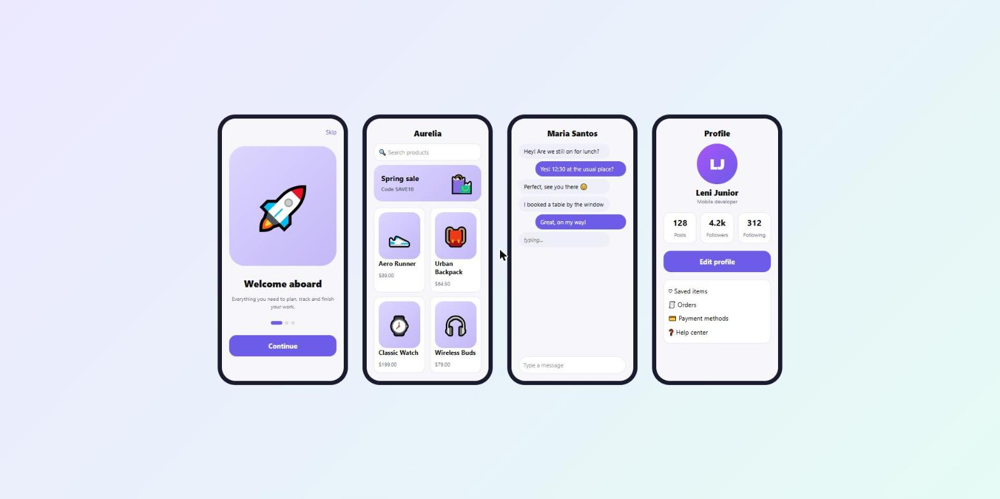

# Flutter UI Kits

Free, copy-and-paste Flutter screens for your next app: **onboarding, e-commerce, chat and profile**. Material 3, light and dark themes, and **no third-party packages**.



*Illustrative preview, drawn to match the kits' design. Run the app to see the real screens.*

## Kits

| Kit | Screens |
| --- | --- |
| Onboarding | 4 swipeable pages, skip button, animated dots |
| Shop | Home with search and categories, product details with size and quantity, cart with promo code (`SAVE10`), checkout form |
| Chat | Inbox with online row and unread badges, chat screen with bubbles, typing indicator and composer |
| Profile | Profile with stats, edit form with validation, settings with a working dark mode switch |

Looking for sign in screens? See [flutter-login-ui-kit](https://github.com/lenivalestevao/flutter-login-ui-kit).

## Run it

This repository contains the Dart code. Create the platform folders once, then run:

```bash
git clone https://github.com/lenivalestevao/flutter-ui-kits.git
cd flutter-ui-kits
flutter create .
flutter pub get
flutter run
```

Requires Flutter 3.10 or newer (Dart 3).

## Use a kit in your app

Each kit lives in its own folder under `lib/`. Copy the folder you want, plus `lib/theme/` and `lib/widgets/common.dart`, and fix the import paths.

```dart
import 'onboarding/onboarding_screen.dart';

OnboardingScreen(onFinished: () => Navigator.of(context).pushReplacementNamed('/home'));
```

## Customize

- Brand color: `AppTheme.brand` in `lib/theme/app_theme.dart`.
- Demo data: `lib/shop/shop_data.dart` and `lib/chat/chat_data.dart`. Replace it with your API.
- Pictures: screens use gradient tiles with emojis so there are no assets. Swap them for `Image` widgets.
- State: the cart is a small `ChangeNotifier`. Swap it for Provider, Riverpod or Bloc if you prefer.

## Notes

- The checkout does not charge anything. Connect your payment provider.
- The chat replies with canned messages so you can try it offline.
- The code was written without a Flutter SDK available, so it has not been compiled or run by its author yet. If `flutter analyze` finds anything, please open an issue.

## License

MIT. Use it in personal and commercial projects.
